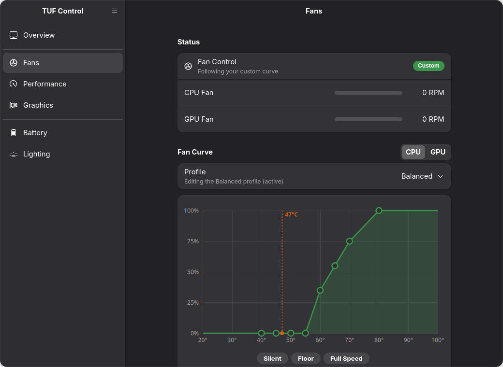
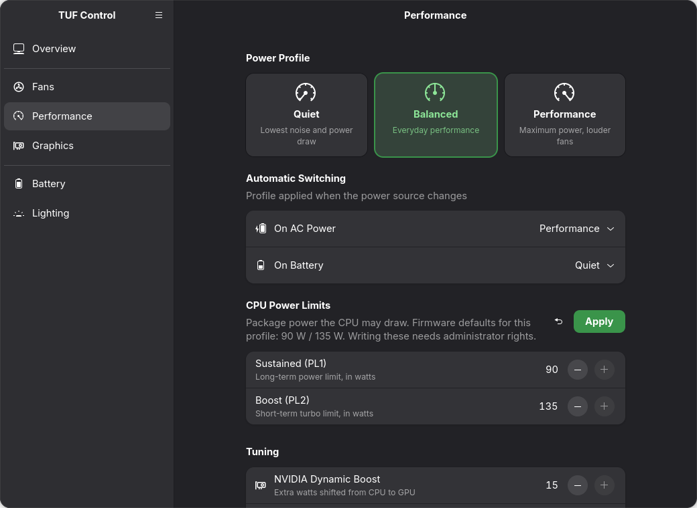
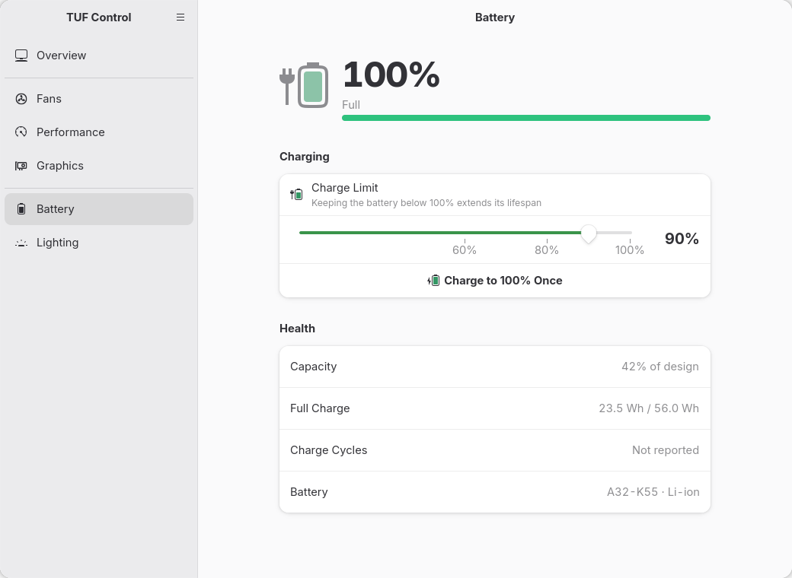
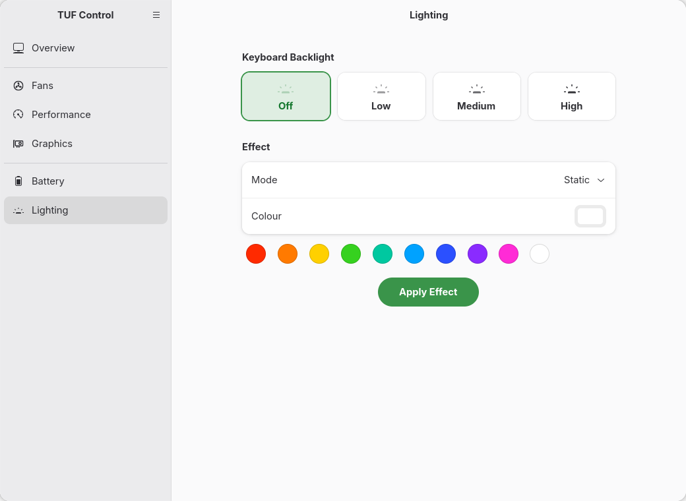
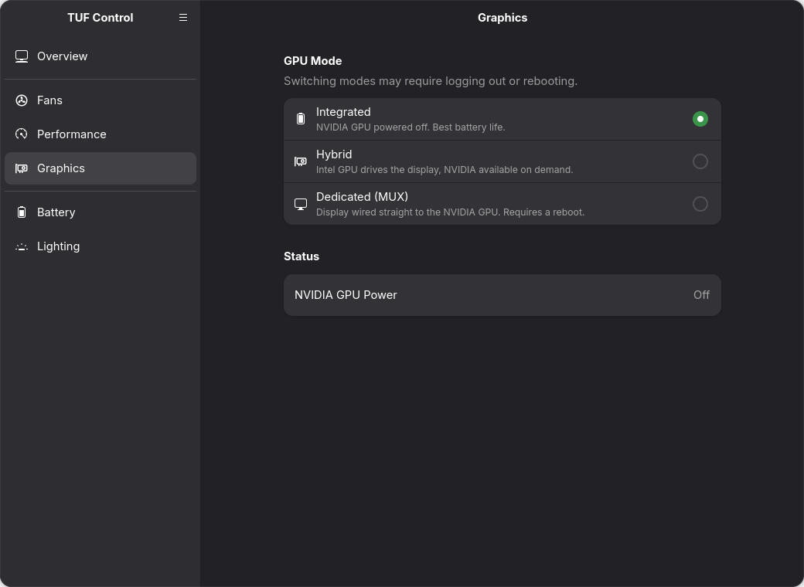
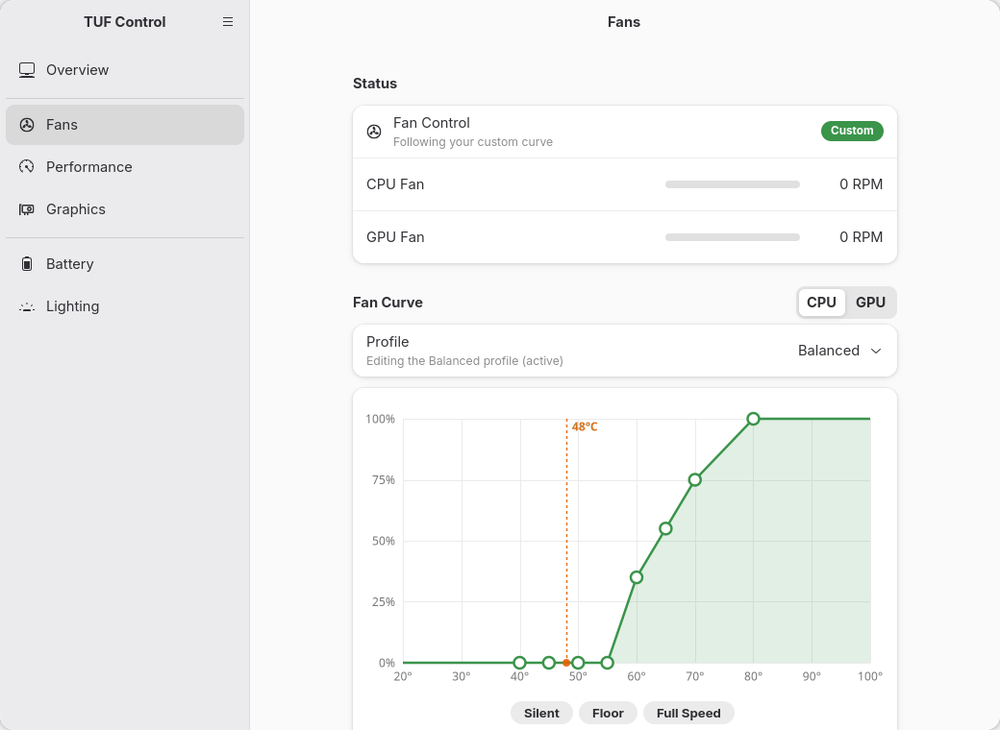

<div align="center">


# TUF Control

**A GNOME-native control center for ASUS TUF & ROG laptops**

Fan curves · power profiles · CPU power limits · battery charge limit · keyboard lighting · GPU mode

A lightweight replacement for *ROG Control Center*, built with GTK 4 and libadwaita so it looks and behaves like the rest of your GNOME desktop.


</div>

## Features

| Page | What it does |
|---|---|
| **Overview** | Live CPU temperature, load, clock, both fan speeds and battery with history sparklines; quick switches for power profile and keyboard backlight |
| **Fans** | Drag-and-drop 8-point fan curve editor per power profile, separate or linked CPU/GPU curves, live temperature marker, Silent / Floor / Full Speed presets, one-click factory reset |
| **Performance** | Quiet / Balanced / Performance profiles, automatic profile on AC vs. battery, CPU power limits (PL1/PL2), NVIDIA Dynamic Boost, panel overdrive |
| **Battery** | Charge limit slider, one-shot charge to 100%, battery health (capacity vs. design, cycles) |
| **Lighting** | Keyboard backlight level, Aura effects (static, breathing, rainbow, pulse) with a colour picker |
| **Graphics** | Integrated / Hybrid / MUX (dGPU) switching via supergfxctl, dGPU power status |

Also:

- **400 MHz clamp detection.** Some models (see [Known issues](#known-issues)) drop the CPU power limits whenever a custom fan curve is enabled, leaving the CPU stuck at 400 MHz. TUF Control re-applies the limits after every curve change and shows a *Fix Now* banner if it detects the clamp.
- Follows the system light/dark style and accent colour, and adapts to narrow windows (phone-size layout).
- No daemon of its own. It talks to `asusd` / `supergfxd` and reads sensors straight from sysfs.

<details>
<summary><b>More screenshots</b></summary>

| | |
|---|---|
|  |  |
|  |  |
|  |  |

</details>

## Tested on

| Laptop | Board | OS | Kernel | Desktop | libadwaita | asusctl | supergfxctl |
|---|---|---|---|---|---|---|---|
| ASUS TUF Gaming F15 (2022) | FX507ZC | Ubuntu 26.10 (development) | 7.3.0 | GNOME 51, Wayland | 1.10 | 6.3.9 | 5.2.4 |

Other ASUS laptops supported by [asusctl](https://asus-linux.org) should work, since every control is feature-detected and hidden when the firmware doesn't expose it. **If you run it on another model, please [open an issue](../../issues/new) with your model and distro, working or not,** so this table can grow.

## Requirements

- An ASUS laptop with the `asus-wmi` / `asus-armoury` kernel drivers (kernel 6.x+; the armoury firmware-attributes interface is needed for power limits, Dynamic Boost and panel overdrive)
- [asusctl / asusd](https://gitlab.com/asus-linux/asusctl) **6.x** (uses `asusctl armoury`)
- [supergfxctl](https://gitlab.com/asus-linux/supergfxctl) *(optional, for the Graphics page)*
- Python 3.10+, GTK 4.12+, libadwaita 1.7+ with PyGObject (libadwaita 1.9+ gives the GNOME Settings–style sidebar)
- polkit (`pkexec`), for changing CPU power limits and resetting fan curves

## Installation

### 1. Install asusctl

Follow the guide for your distro at **<https://asus-linux.org/guides/>** and make sure `asusd` is running:

```sh
systemctl status asusd
asusctl info
```

### 2. Install the GTK / libadwaita bindings

```sh
# Ubuntu / Debian
sudo apt install python3-gi gir1.2-gtk-4.0 gir1.2-adw-1

# Fedora
sudo dnf install python3-gobject gtk4 libadwaita

# Arch Linux
sudo pacman -S python-gobject gtk4 libadwaita
```

### 3. Install TUF Control

```sh
git clone https://github.com/erfanium/tuf-control.git ~/.local/share/tuf-control
cd ~/.local/share/tuf-control
./install.sh
```

This adds **TUF Control** to your app grid and a `tuf-control` command in `~/.local/bin`. The launcher points at the cloned folder, so keep it there (update with `git pull`).

### 4. (Optional) Password-free power limits

Changing CPU power limits and resetting the fan curve need root, so by default you get a polkit password prompt each time. To skip it, install the small privileged helper and its polkit policy:

```sh
./install.sh --system
```

The helper (`/usr/local/libexec/tuf-control-helper`) is root-owned and only accepts two fixed operations: writing range-checked PL1/PL2 values, and restoring the factory fan curve. The policy allows it without a password **only for the active local session**. Read [`data/tuf-control-helper`](data/tuf-control-helper) and [the policy](data/io.github.erfanium.TufControl.policy) before installing.

### Run without installing

```sh
./tuf-control
# or
python3 -m tufcontrol
```

### Uninstall

```sh
./uninstall.sh            # launcher + icon
./uninstall.sh --system   # also the privileged helper
```

## How it works

| Feature | Backend |
|---|---|
| Sensors (temps, fans, clocks, battery) | sysfs: `hwmon` (`coretemp`, `asus`, `nvme`), `/proc/stat`, `power_supply` |
| Fan curves | `asusctl fan-curve --mod-profile … --fan cpu/gpu --data …`, then `--enable-fan-curves true` |
| Power profiles | `asusctl profile set [-a / -b]` |
| PL1 / PL2 | `/sys/class/firmware-attributes/asus-armoury/attributes/ppt_pl{1_spl,2_sppt}` via `pkexec` |
| Dynamic Boost, panel overdrive | `asusctl armoury set` |
| Charge limit | `asusctl battery limit` / `oneshot` |
| Keyboard | `asusctl leds set`, `asusctl aura effect …` |
| GPU mode | `supergfxctl -m` |

UI settings (linked fans, last lighting colours) are stored in `~/.config/tuf-control/state.json`.

## Known issues

- **CPU stuck at 400 MHz with a custom fan curve (FX507 / FX517 and likely others).** The BIOS drops PL1/PL2 when a custom curve is enabled. TUF Control re-writes the firmware default limits right after applying a curve (the same workaround G-Helper uses). `asusd` may restore the curve again on boot or resume, which re-triggers the clamp. The banner catches that, or you can run *Fans → Re-apply CPU Power Limits*. For a fully automatic fix at boot/resume, run a small systemd unit that re-applies the limits a few seconds after `asusd` starts.
- Fan curves are stored **per power profile**. The editor opens the active profile's curve; switching profile switches curves.
- Aura effects vary by model. If an effect isn't supported, asusd returns an error and you'll see it as a toast.

## Project layout

```
tuf-control              launcher script
tufcontrol/
  app.py                 Adw.Application, window, sidebar, sensor polling
  pages.py               Overview, Fans, Performance, Battery, Lighting, Graphics
  curve.py               Cairo fan-curve editor and sparkline widgets
  backend.py             sysfs + asusctl/supergfxctl/pkexec wrappers (all async)
data/
  tuf-control-helper     optional root helper (PPT, fan curve reset)
  *.policy, *.desktop    polkit policy and launcher
  icons/                 app icon and symbolic icons
```

## Contributing

Issues and pull requests are welcome, especially test reports from other ASUS models. When filing a bug, please include:

```sh
asusctl info
asusctl armoury list
cat /sys/class/dmi/id/product_name
ls /sys/class/hwmon/*/name | xargs -I{} sh -c 'echo {}: $(cat {})'
```

Keep the UI within the [GNOME Human Interface Guidelines](https://developer.gnome.org/hig/) and use stock libadwaita widgets where one exists.

## Acknowledgements

- [asusctl & supergfxctl](https://asus-linux.org) by the asus-linux team, which do all the heavy lifting
- [G-Helper](https://github.com/seerge/g-helper), for the power-limit workaround and fan-curve presets inspiration

## License

[GPL-3.0-or-later](LICENSE). Not affiliated with or endorsed by ASUSTeK Computer Inc.; ASUS, TUF and ROG are trademarks of their respective owners.
